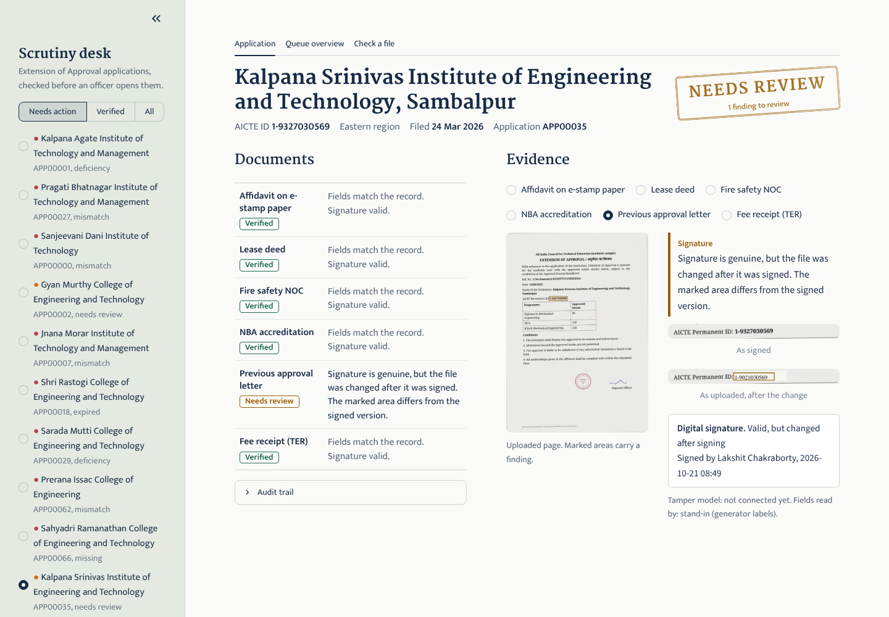
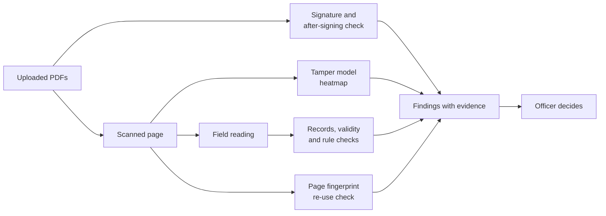

# Scrutiny Desk

**AI-assisted checking of AICTE approval applications: catches edited, expired, unsigned, mismatched and re-used documents before an officer opens the file, and shows the evidence for every finding.**

Smart India Hackathon 2026 · Problem statement **SIH26261** (AICTE): *AI-powered application validation, document authentication and regulatory compliance verification.*

> Everything in this repository is synthetic: institutions, people, numbers, documents and records are generated.
> No real AICTE, NBA or government document, logo or seal is used.



## What it does

An institution applying for Extension of Approval uploads a set of documents: affidavit, lease deed, fire NOC, NBA certificate, previous approval letter and fee receipt. Today an officer checks each one by eye. Scrutiny Desk checks them all first and gives each application a clear status: **verified**, **deficiency** or **manual review**, with the reason and the proof next to it. The officer still decides; the desk only points.

| Check | What it catches | How |
| --- | --- | --- |
| **Edited image** | A digit, name or date repainted in the scanned page | Fine-tuned FFDN tamper model; a heatmap marks the edited area |
| **Changed after signing** | Text covered and retyped after the PDF was digitally signed (the signature still "verifies") | Signed revision compared with the uploaded file; the changed area is boxed |
| **Signature** | Unsigned or invalid documents | pyHanko validation against the trust root |
| **Records** | Institution name or AICTE ID that differs from the AICTE record | Field against record, differing characters marked |
| **Validity** | Certificates expired before the filing date | Dates against the filing date |
| **Rules** | Lease shorter than the longest course; intake above approval | Approval Process Handbook rules (e.g. cl. 2.1(e)) |
| **Re-use** | The same page uploaded by another institution | Page fingerprint, confirmed pixel by pixel |
| **Missing** | Required documents not uploaded | Extension of Approval checklist |



## Results

### Tamper model

1,607 test pages (609 edited, 998 genuine) from institutions the model never saw, including a page layout that never appears in training.
A page is flagged when the largest area the model marks is at least 143 pixels; that cut-off was chosen on 1,555 separate validation pages, allowing at most 1% of genuine pages to be flagged there.

| Model | Edited pages caught | Genuine pages wrongly flagged | One-digit insertions caught | Edit outline (pixel F1) |
| --- | --- | --- | --- | --- |
| FFDN as published (trained on DocTamper)* | 90.0% | 84.3% | – | 0.106 |
| Fine-tuned, v1 | 87.7% | 1.4% | 9.8% | 0.848 |
| **Fine-tuned, v2 (used in the app)** | **96.2%** | **1.1%** | **82.9%** | **0.920** |

\* Scored with its default rule (99.9th-percentile pixel ≥ 0.5). Out of the box it flags almost every page, genuine or not.

v2 continues from v1 with two changes: *hard negatives* (training on the exact spots where v1 wrongly fired on genuine pages, plus genuine text) and choosing the epoch with the same rule the app uses. Page-level AUC: 0.980 (v1: 0.962). Per-page scores for every model are in [`results/`](results).

### Rule checks

On 150 generated applications, every planted problem of the rule-based types (every row of the table above except *Edited image*) was caught, with no false alarms on 748 clean documents (`app/score_engine.py`). These runs use a stand-in reader that knows each printed field exactly; they will be re-measured once a trained reader extracts the fields from the page.

## Run it

```
git clone https://github.com/Dynemies/scrutiny-desk.git
cd scrutiny-desk/app
pip install -r requirements.txt
streamlit run app.py
```

Opens at http://localhost:8501 with 14 sample applications. Results are precomputed, so the demo runs on any laptop, without a GPU or the model file.

To try the documents yourself, see [`samples/`](samples): one genuine application and nine documents with a different problem each.

## Model weights

`ffdn_v2_best.pth` (about 357 MB) is attached to the [Releases](../../releases) page. It is only needed to re-run the tamper model, not to use the app.
The weights are fine-tuned from ForensicHub's FFDN document checkpoint, which was trained on DocTamper, so they are released **for research and evaluation only**. See [NOTICE.md](NOTICE.md).

## Reproduce

Everything was trained on Kaggle (2× T4). Each step is one notebook cell with its paths at the top.

| Step | File | Time |
| --- | --- | --- |
| 1. Generate 2,000 synthetic applications | `generator/generate_aicte_synth.py`, check with `generator/sanity_check_cell.py` | about 75 min |
| 2. Score FFDN as published | `training/baseline_ffdn.py` | about 1 h |
| 3. Fine-tune v1 (8 epochs) | `training/kaggle/finetune_one_cell.py` | about 4.5 h |
| 4. Score page rules for v1 | `training/kaggle/rescore_one_cell.py`, then `training/analysis/analyze_rescore.py` | about 1 h |
| 5. Fine-tune v2 (hard negatives, 4 epochs) | `training/kaggle/finetune_v2_one_cell.py` | about 3.5 h |
| 6. Choose the v2 epoch on full validation | `training/kaggle/rescore_v2_one_cell.py`, then `training/analysis/analyze_v2.py` | about 2 h |
| 7. Heatmaps for the app's demo pages | `training/kaggle/demo_heatmaps_one_cell.py` | a few minutes |

Each training epoch runs in its own fresh process, so host memory cannot build up over a long run, and the training cells pick up where they stopped if a session ends.

## Limits

- Tested on synthetic documents. They imitate real scans (paper tint, slight rotation, sensor noise, JPEG re-saves, three layouts), but real uploads will differ. Real samples are the next test.
- Edits pasted from another of our own generated pages, in the same font and on the same paper, leave almost no pixel trace. Most of the remaining misses are like this. Checking printed numbers against the issuer's register (payment ledger, e-stamp, NOC and NBA records) would cover them.
- About 1 in 100 genuine pages is flagged. Some of these marks are box-shaped, over a date or reference number. Flags go to an officer for review and never reject anything on their own.
- Field reading in this prototype is a stand-in; the trained reader is the next step.

## Repository

```
app/          Streamlit desk, check engine, 14 demo applications with precomputed results
generator/    Synthetic application generator (documents, signatures, planted problems, answer keys)
training/     Fine-tuning and scoring scripts, one-cell Kaggle versions, analysis
results/      Per-page scores and training history for every model
samples/      Genuine and problem documents to try
docs/         Screenshots and figures
```

## Licence

AGPL-3.0 (this project uses PyMuPDF, which is AGPL-3.0). Third-party code, models and fonts keep their own licences; see [NOTICE.md](NOTICE.md).
